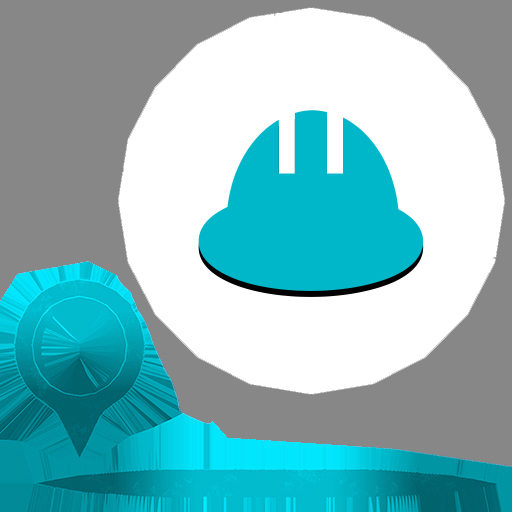
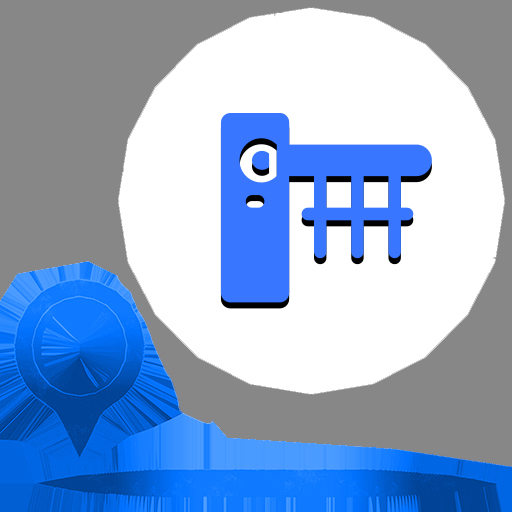
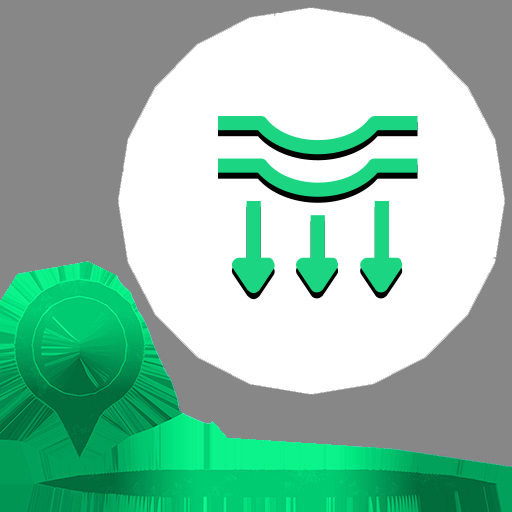
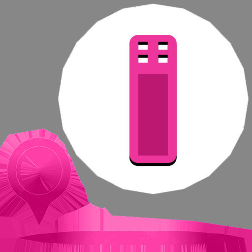
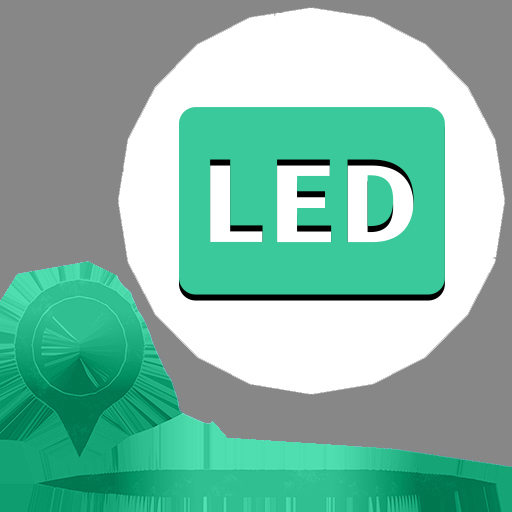
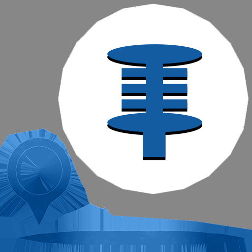
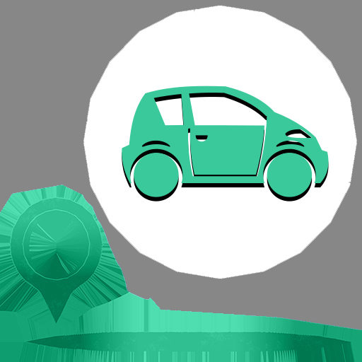
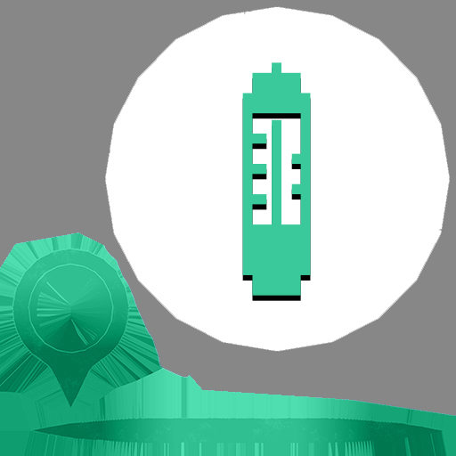
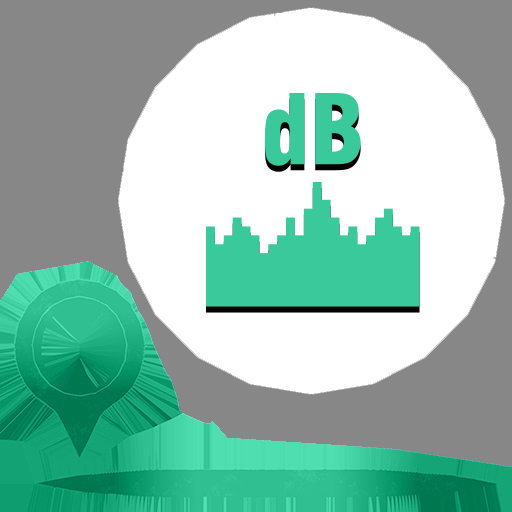

# InsBimPlusViewer 外部 API 文档

在 InsBimPlusViewer 组件外部操作 3D 场景的工具类，通过 NPM 包引入即可使用。

## 引入方式

```js
import { bimControls } from '@ins/vam2-plugin-bim'
```

> 需在 `<InsBimPlusViewer>` 组件的 `@ready` 事件触发后才能调用，此时查看器实例已注册。

## 多实例支持

支持同一页面多个 `<InsBimPlusViewer>` 实例。所有方法**最后一个参数**为 `viewerId`（可选）：

- **单实例**：省略 `viewerId`，自动操作第一个注册的实例
- **多实例**：传入目标 viewer 的 `viewerId`，精确操作指定实例

```js
// 单实例用法
bimControls.highlightPart('Wall_001')

// 多实例用法
bimControls.highlightPart('Wall_001', 'ins-bim-viewer-twin')
```

```html
<InsBimPlusViewer ref="viewerA" />
<InsBimPlusViewer ref="viewerB" :viewerId="'ins-bim-viewer-twin'" />
```

---

## 组件事件

`<InsBimPlusViewer>` 组件通过 Vue 事件向外通知状态变化：

| 事件 | payload | 触发时机 |
|------|---------|----------|
| `ready` | `BimViewerController` | 场景初始化完成（DOM 挂载 + 渲染循环启动），可查看器实例 |
| `gltf-pick` | `Object \| null` | 点击 GLB 模型部件时触发；点击空白处 payload 为 `null` |
| `label-click` | `Object` | 点击 3D 标签时触发，含 `{ id, name, ... }` |
| `model-loaded` | `{ id, url }` | 单个 GLB 模型加载完成 |
| `error` | `{ type, error, id?, url? }` | 加载失败时触发，`type` 为 `'tileset'` 或 `'gltf'` |

**gltf-pick 的 info 字段：**

| 字段 | 类型 | 说明 |
|------|------|------|
| `object` | `THREE.Object3D` | 被点击的网格对象 |
| `name` | `string` | 网格名称 |
| `path` | `string` | 层级路径（如 `Root/Building/Wall_001`） |
| `worldPosition` | `THREE.Vector3` | 点击点世界坐标 |
| `localPosition` | `THREE.Vector3` | 点击点局部坐标 |
| `screenPosition` | `{x, y}` | 点击点屏幕坐标（像素） |
| `model` | `THREE.Group` | 所属模型根节点 |

```vue
<InsBimPlusViewer
    @ready="onReady"
    @gltf-pick="onPick"
    @label-click="onLabelClick"
    @model-loaded="onModelLoaded"
    @error="onError"
/>
```

```js
methods: {
    onReady(controller) {
        // controller 为底层 BimViewerController 实例
        // 也可直接使用 bimControls 操作
    },
    onPick(info) {
        if (!info) return // 点击了空白处
        console.log(`点击了部件: ${info.name} (${info.path})`)
        console.log('世界坐标:', info.worldPosition)
    },
    onLabelClick(info) {
        console.log(`点击了标签: ${info.name} (ID: ${info.id})`)
    },
    onModelLoaded({ id, url }) {
        console.log(`模型加载完成: ${id}`)
    },
    onError({ type, error, id, url }) {
        console.warn(`${type} 加载失败:`, error)
    },
}
```

---

## 数据加载

### `loadTilesets(sources, viewerId?)`

加载 3D Tiles 地形数据。

| 参数 | 类型 | 说明 |
|------|------|------|
| `sources` | `Array<{id, url, name?, visible?}>` | 地形数据源列表 |

**sources 字段说明：**

| 字段 | 类型 | 默认值 | 说明 |
|------|------|--------|------|
| `id` | `string` | — | 数据源唯一标识 |
| `url` | `string` | — | tileset.json 地址 |
| `name` | `string` | `id` | 显示名称 |
| `visible` | `boolean` | `true` | 加载后是否可见（`null`/`undefined` 视为 `true`） |

```js
bimControls.loadTilesets([
    { id: 'rm-tileset', name: 'RM地形', url: 'http://server/data/3dtiles/rm/tileset.json' },
    { id: 'bg-tileset', name: '背景地形', url: 'http://server/data/3dtiles/bg/tileset.json', visible: false },
])
```

---

### `loadGltfModels(sources, geoOrigin?, viewerId?)`

依次加载 GLTF/GLB 模型。若之前调用过 `applyMaterialConfig`，会自动将材质配置应用到新加载的模型。

| 参数 | 类型 | 说明 |
|------|------|------|
| `sources` | `Array<{id, url, name?, visible?}>` | 模型数据源列表 |
| `geoOrigin` | `Object` | 可选，地理配准原点（对应 `sceneConfig.geoOrigin`），不传则不做地理配准 |

**sources 字段说明：**

| 字段 | 类型 | 默认值 | 说明 |
|------|------|--------|------|
| `id` | `string` | — | 数据源唯一标识 |
| `url` | `string` | — | GLB/GLTF 文件地址 |
| `name` | `string` | — | 显示名称（用于模型树和路径展示） |
| `visible` | `boolean` | `true` | 加载后是否可见（`null`/`undefined` 视为 `true`） |

**geoOrigin 字段说明：**

| 字段 | 类型 | 说明 |
|------|------|------|
| `centralMeridianDeg` | `number` | 高斯-克吕格中央子午线经度（度） |
| `offsetX` | `number` | 模型原点投影东坐标（米） |
| `offsetY` | `number` | 模型原点投影北坐标（米） |
| `offsetZ` | `number` | 模型原点高程（米），默认 `0` |
| `verticalScale` | `number` | 垂直缩放比例，默认 `1` |

```js
// 不传 geoOrigin（无地理配准）
bimControls.loadGltfModels([
    { id: 'rm-glb', name: 'RM模型', url: 'http://server/data/gltf/rm/RM_.glb' },
    { id: 'rm-model', name: '隧道模型', url: 'http://server/data/gltf/rm/model.glb', visible: false },
])

// 传入 geoOrigin（加载时即完成地理配准）
bimControls.loadGltfModels(
    [{ id: 'rm-glb', name: 'RM模型', url: 'http://server/data/gltf/rm/RM_.glb' }],
    { centralMeridianDeg: 99, offsetX: 436200, offsetY: 3282400, offsetZ: 2000 }
)
```

---

### `renderLabels(config, viewerId?)`

加载并渲染 3D 标签，完成后自动飞行到标签位置。

| 参数 | 类型 | 说明 |
|------|------|------|
| `config` | `Object` | 标签配置对象（含 `type`、`list` 字段） |

**list 项字段说明：**

| 字段 | 类型 | 必填 | 说明 |
|------|------|------|------|
| `id` | `number \| string` | 是 | 标签唯一 ID |
| `name` | `string` | 是 | 标签名称（显示在名称牌上） |
| `longitude` | `number` | 是 | 经度 |
| `latitude` | `number` | 是 | 纬度 |
| `altitude` | `number` | 否 | 高程（米），默认 0 |
| `model` | `string` | 否 | 模型 ID（如 `L05`）或文件路径，默认 `L06`。见 `label-assets.js` |

**opts 字段说明（按重要程度排列）：**

| 字段 | 类型 | 默认值 | 说明 |
|------|------|--------|------|
| `texture` | `string` | `''` | 贴图 ID（如 `T0538`）或文件路径。见 `label-assets.js` |
| `ringColor` | `string` | `'#fff'` | 圆环/涟漪/名称牌主题色，CSS 颜色值 |
| `scale` | `number` | `200` | 整体缩放 |
| `labelHeight` | `number` | `0.2` | 图标离地高度 |
| `emissiveBoost` | `number` | `0.3` | 自发光增亮强度，不改变图标颜色仅提升亮度（0=关闭，建议 0.2~0.5） |
| `showName` | `boolean` | `true` | 是否显示名称牌 |
| `nameTagStyle` | `string` | `'stacked'` | 名称牌样式：`bubble` / `glow` / `plaque` / `stacked` |
| `nameTagHeight` | `number` | `1.5` | 名称牌偏移距离 |
| `nameTagScale` | `number` | `1` | 名称牌大小 |
| `nameTagOrientation` | `string` | `'vertical'` | 名称牌方向：`vertical` / `horizontal` |
| `nameTagRot` | `number` | `0` | 名称牌旋转角度（度） |
| `animEnabled` | `boolean` | `false` | 动画开关 |
| `animationType` | `string` | `'bounce'` | 动画类型：`bounce` / `rotate` / `both` / `none` |
| `rippleEnabled` | `boolean` | `true` | 底部涟漪开关 |
| `rotation` | `number` | `0` | 整体 Y 轴旋转角度（度） |
| `phase` | `number` | `null` | 动画相位，null 则随机 |

```js
bimControls.renderLabels({
    type: 'label',
    list: [
        {
            id: 1,
            name: '料仓场地',
            longitude: 98.348505,
            latitude: 29.633465,
            altitude: 2711.1,
            model: 'L05',
            opts: {
                ringColor: '#88ddff',
                animationType: 'bounce',
                animEnabled: true,
                scale: 200,
                labelHeight: 0.3,
                rippleEnabled: true,
                showName: true,
                nameTagStyle: 'glow',
                nameTagHeight: 1.3,
                nameTagScale: 1.5,
                nameTagRot: 0,
                nameTagOrientation: 'vertical',
                texture: 'T0538',
                rotation: 0,
            },
        },
    ],
})
```

### 模型资源表

| ID | Key | 名称 | 模型文件 |
|----|-----|------|----------|
| `L01` | `label_a` | 标签 A | `label_a.glb` |
| `L02` | `label_b` | 标签 B | `label_b.glb` |
| `L03` | `label_c` | 标签 C | `label_c.glb` |
| `L04` | `label_d` | 标签 D | `label_d.glb` |
| `L05` | `label_e` | 标签 E | `label_e.glb` |
| `L06` | `label_e2` | 标签 E2 | `label_e2.glb`（默认模型） |

### L05 / L06 贴图资源表

> L06（label_e2）复用 L05 的贴图资源。配置中使用 `texture: 'T05xx'` 即可。

| ID | 预览 | 名称 | 文件 | 分类 |
|----|------|------|------|------|
| `T0501` |  | 安防计算机 | `security_computer.jpg` | 设备/服务器 |
| `T0502` |  | 安全帽型定位标签 | `helmet_tag.jpg` | 定位/标签 |
| `T0503` |  | 车辆测速一体机 | `veh_speed.jpg` | 车辆 |
| `T0504` |  | 车辆道闸（栅栏型） | `gate_fence.jpg` | 道闸/门禁 |
| `T0505` |  | 车辆道闸（直杆型） | `gate_straight.jpg` | 道闸/门禁 |
| `T0506` |  | 车辆监控主体 | `veh_mon.jpg` | 车辆 |
| `T0507` |  | 车载定位终端 | `veh_pos.jpg` | 定位/标签 |
| `T0508` |  | 沉降环 | `settle_ring.jpg` | 工程/安全 |
| `T0509` |  | 道路预警机 | `road_warn.jpg` | 工程/安全 |
| `T0510` |  | 吊牌型定位标签 | `hang_tag.jpg` | 定位/标签 |
| `T0511` |  | 定位基站 | `loc_base.jpg` | 定位/标签 |
| `T0512` |  | 工业车辆 | `ind_veh.jpg` | 车辆 |
| `T0513` |  | 固定枪机 | `cam_bullet.jpg` | 摄像头 |
| `T0514` |  | 固定球型摄像头（防爆） | `cam_expl_dome.jpg` | 摄像头 |
| `T0515` |  | 固定智能球型摄像头 | `cam_smart_dome.jpg` | 摄像头 |
| `T0516` |  | 管理人员 | `mgmt_staff.jpg` | 人员 |
| `T0517` |  | 户外LED大屏 | `led_screen.jpg` | 设备/服务器 |
| `T0518` |  | 环境监控 | `env_mon.jpg` | 监测/环境 |
| `T0519` |  | 混凝土车辆 | `concrete_veh.jpg` | 车辆 |
| `T0520` |  | 监测点 | `mon_point.jpg` | 监测/环境 |
| `T0521` |  | 控制主机 | `control_host.jpg` | 设备/服务器 |
| `T0522` |  | 流量计 | `flow_meter.jpg` | 监测/环境 |
| `T0523` |  | 普通车辆 | `ord_veh.jpg` | 车辆 |
| `T0524` |  | 起重机 | `crane.jpg` | 工程/安全 |
| `T0525` |  | 气象监测 | `weather_mon.jpg` | 监测/环境 |
| `T0526` |  | 三辊闸 | `tri_gate.jpg` | 道闸/门禁 |
| `T0527` |  | 视频监控存储设备 | `video_storage.jpg` | 设备/服务器 |
| `T0528` |  | 视频平台管理服务器 | `video_server.jpg` | 设备/服务器 |
| `T0529` |  | 收扩机（通讯终端） | `comm_terminal.jpg` | 设备/服务器 |
| `T0530` |  | 塔吊 | `t_crane.jpg` | 工程/安全 |
| `T0531` |  | 通用车辆 | `gen_veh.jpg` | 车辆 |
| `T0532` |  | 土体位移计 | `soil_gauge.jpg` | 监测/环境 |
| `T0533` |  | 危化品 | `haz_chem.jpg` | 工程/安全 |
| `T0534` |  | 无线网桥 | `wireless_bridge.jpg` | 设备/服务器 |
| `T0535` |  | 压力容器 | `pressure_vessel.jpg` | 工程/安全 |
| `T0536` |  | 扬尘监测 | `dust_mon.jpg` | 监测/环境 |
| `T0537` |  | 翼闸（左中右） | `flap_gate.jpg` | 道闸/门禁 |
| `T0538` |  | 智能轻便型便携球机 | `cam_dome.jpg` | 摄像头 |
| `T0539` |  | 智能巡检AI服务器 | `ai_server.jpg` | 设备/服务器 |
| `T0540` |  | 污水 | `sewage.jpg` | 监测/环境 |
| `T0541` |  | 扬尘噪声 | `dust_noise.jpg` | 监测/环境 |

> 图片文件位于 `public/assets/model/image/` 目录下。

---

## 配置管理（整体替换）

### `applyEnvConfig(config, viewerId?)`

应用环境配置（天空/HDR/光照/曝光），覆盖当前所有环境参数。

| 参数 | 类型 | 说明 |
|------|------|------|
| `config` | `Object` | 配置对象 |

```js
import sceneConfig from './config/bim-scene-config.js'
bimControls.applyEnvConfig(sceneConfig.envConfig)
```

---

### `applyMaterialConfig(config, viewerId?)`

应用材质映射配置，并重新应用到所有已加载的 GLB 模型。后续调用 `loadGltfModels` 时也会自动应用此配置。

| 参数 | 类型 | 说明 |
|------|------|------|
| `config` | `Array` | 配置数组 |

```js
import materialConfig from './config/material-config.js'
bimControls.applyMaterialConfig(materialConfig)
```

---

### `applyCameraConfig(cfg, viewerId?)`

设置相机位置和观察目标。缺省项保持当前值。

| 参数 | 类型 | 说明 |
|------|------|------|
| `cfg` | `Object` | `{ position?: {x,y,z}, target?: {x,y,z} }` |

```js
bimControls.applyCameraConfig({
    position: { x: 100, y: 200, z: 300 },
    target: { x: 0, y: 0, z: 0 },
})
```

---

### `getCameraInfo(viewerId?)`

获取当前相机位置和观察目标，返回格式与 `biz-config.js` 的 `camera` 配置一致，可直接用于 `applyCameraConfig`。

| 参数 | 类型 | 说明 |
|------|------|------|
| **返回** | `Object \| null` | `{ position: {x,y,z}, target: {x,y,z} }` |

```js
const info = bimControls.getCameraInfo()
console.log(info)
// { position: { x: 0, y: 3000, z: 4000 }, target: { x: 0, y: 0, z: 0 } }

// 保存当前视角，稍后恢复
const savedView = bimControls.getCameraInfo()
// ... 操作后恢复
bimControls.applyCameraConfig(savedView)
```

---

### `resetCamera(cameraConfig?, duration?, viewerId?)`

回归视角。传入 cameraConfig 时平滑飞行到指定位置，否则优先读取 `biz-config.js` 配置，均无配置时自动聚焦到已加载场景的包围盒中心。

| 参数 | 类型 | 默认值 | 说明 |
|------|------|--------|------|
| `cameraConfig` | `Object` | — | 相机配置（可选） |
| `cameraConfig.position` | `{ x, y, z }` | — | 相机位置 |
| `cameraConfig.target` | `{ x, y, z }` | — | 观察目标点 |
| `duration` | `number` | `3000` | 飞行动画时长（毫秒） |

```js
// 回归初始视角（默认 3 秒平滑飞行）
bimControls.resetCamera()

// 飞行到指定位置
bimControls.resetCamera({
    position: { x: -4166, y: 2500, z: 5035 },
    target: { x: 0, y: 0, z: 0 },
})

// 自定义飞行时长
bimControls.resetCamera(null, 1000)
```

---

## 运行时细粒度调参

### `setEnvParam(key, value, viewerId?)`

修改单个环境参数并立即生效。`key` 支持点分路径。

| 参数 | 类型 | 说明 |
|------|------|------|
| `key` | `string` | 点分路径（如 `'envLight.exposure'`） |
| `value` | `any` | 参数值 |

**支持的 key：**

| key | 说明 | 取值范围 |
|-----|------|----------|
| `dirLight.intensity` | 主方向光强度 | 0~10 |
| `dirLight.yaw` | 主方向光水平角度 | 0~360 度 |
| `dirLight.pitch` | 主方向光俯仰角度 | 0~90 度 |
| `dirLight.color` | 主方向光颜色 | CSS 颜色值 |
| `dirLight.shadow.enabled` | 阴影开关 | true/false |
| `dirLight.shadow.resolution` | 阴影贴图分辨率 | 512/1024/2048/4096 |
| `dirLight.shadow.range` | 阴影相机范围 | 数值（米），默认 62 |
| `dirLight.shadow.offsetX` | 阴影 X 偏移 | 数值 |
| `dirLight.shadow.offsetY` | 阴影 Y 偏移 | 数值 |
| `dirLight.shadow.bias` | 阴影偏移修正 | 数值，默认 -0.001 |
| `envLight.intensity` | IBL 环境光强度 | 0~5 |
| `envLight.bgIntensity` | 背景强度 | 0~5 |
| `envLight.exposure` | 色调映射曝光 | 0.1~5 |
| `envMapEnabled` | 环境贴图/背景显隐 | true/false |
| `bloom.enabled` | 后期泛光开关 | true/false |
| `bloom.strength` | 泛光强度 | 0~5，默认 0.001 |
| `bloom.radius` | 泛光扩散半径 | 0~2，默认 0 |
| `bloom.threshold` | 泛光亮度过滤阈值 | 0~1，默认 0 |

```js
// 微调曝光
bimControls.setEnvParam('envLight.exposure', 2.0)

// 调整光照方向和强度
bimControls.setEnvParam('dirLight.intensity', 3.0)
bimControls.setEnvParam('dirLight.yaw', 120)

// 关闭环境贴图
bimControls.setEnvParam('envMapEnabled', false)
```

> **规则**：`applyEnvConfig` 会覆盖所有参数重建基准；`setEnvParam` 是在当前基准上局部修改。两者可交替使用。

---

### `getEnvConfig(viewerId?)`

返回当前环境配置对象（只读快照），可用于读取当前参数值。

```js
const cfg = bimControls.getEnvConfig()
console.log(cfg.envLight.exposure) // 1.3
```

---

## 部件操作

### `getModelTreeById(id, viewerId?)`

通过来源 ID 获取模型结构树，返回递归树形数据。

| 参数 | 类型 | 说明 |
|------|------|------|
| `id` | `string` | 模型来源 ID（对应 `gltfSources[].id`） |
| **返回** | `Object \| null` | 树结构数据，含 `id`、`name`、`type`、`children` 字段 |

```js
const tree = bimControls.getModelTreeById('rm-model')
if (tree) {
    console.log(tree.name)   // '隧道模型'
    console.log(tree.children) // 子节点数组
}
```

---

### `findPartByName(name, viewerId?)`

按名称查找部件，返回结构化信息（与 `gltf-pick` 事件 info 格式一致）。

| 参数 | 类型 | 说明 |
|------|------|------|
| `name` | `string` | 部件名称 |
| **返回** | `Object \| null` | `{ object, name, path, worldPosition, localPosition, screenPosition, model }` |

```js
const info = bimControls.findPartByName('Wall_001')
if (info) {
    console.log(info.worldPosition)
}
```

---

### `setPartMaterial(name, matKey, viewerId?)`

按部件名称修改材质。传入空字符串或 falsy 值时重置回 GLB 原始材质（同时移除线框覆盖层）。

| 参数 | 类型 | 说明 |
|------|------|------|
| `name` | `string` | 网格名称 |
| `matKey` | `string \| THREE.Material` | 材质库 ID（如 `'m5'`）、线框材质 ID（如 `'m58'`）或 THREE.Material 实例；falsy 值重置为原始材质 |
| **返回** | `boolean` | 是否成功 |

```js
// 使用材质库 ID
bimControls.setPartMaterial('Wall_001', 'm5')

// 使用线框材质
bimControls.setPartMaterial('Wall_001', 'm58')

// 使用自定义材质
const mat = new THREE.MeshStandardMaterial({ color: 0xff0000 })
bimControls.setPartMaterial('Wall_001', mat)

// 重置回原始材质
bimControls.setPartMaterial('Wall_001', '')
```

---

### `highlightPart(name, viewerId?)`

按名称高亮部件（半透明 + 轮廓线）并飞行聚焦。

| 参数 | 类型 | 说明 |
|------|------|------|
| `name` | `string` | 部件名称 |
| **返回** | `Object \| false` | 部件信息或 false |

```js
const info = bimControls.highlightPart('Roof_001')
```

---

### `setPartVisible(name, visible, viewerId?)`

按名称设置部件显隐。

| 参数 | 类型 | 说明 |
|------|------|------|
| `name` | `string` | 部件名称 |
| `visible` | `boolean` | 是否可见 |
| **返回** | `boolean` | 是否成功 |

```js
bimControls.setPartVisible('Wall_001', false)
bimControls.setPartVisible('Wall_001', true)
```

---

### `clearHighlight(viewerId?)`

清除当前高亮状态。

```js
bimControls.clearHighlight()
```

---

## 标注管理

### `addAnnotation(position, element, vueApp?, viewerId?)`

在 3D 世界坐标处添加 HTML 标注。

| 参数 | 类型 | 说明 |
|------|------|------|
| `position` | `THREE.Vector3` | 世界坐标 |
| `element` | `HTMLElement` | DOM 元素 |
| `vueApp` | `Object` | 可选，关联的 Vue app 实例，清理时自动 unmount |

```js
import { createApp } from 'vue'
import PartInfoLabel from './PartInfoLabel.vue'

const el = document.createElement('div')
const app = createApp(PartInfoLabel, { name: '部件A', path: '/root/wall' })
app.mount(el)

bimControls.addAnnotation(info.worldPosition, el, app)
```

---

### `clearAnnotations(viewerId?)`

清除所有 HTML 标注（自动 unmount 关联的 Vue 组件）。

```js
bimControls.clearAnnotations()
```

---

## 图层控制

### `controlEnvEnabled(enabled, viewerId?)`

控制环境贴图是否启用。

| 参数 | 类型 | 说明 |
|------|------|------|
| `enabled` | `boolean` | 是否启用环境贴图 |

```js
bimControls.controlEnvEnabled(false)
```

---

### `setModelVisible(id, visible, type?, viewerId?)`

根据来源 ID 设置模型显隐，支持 3D Tiles 和 GLB/GLTF。

| 参数 | 类型 | 说明 |
|------|------|------|
| `id` | `string` | 数据源 ID（加载时传入的 `id`） |
| `visible` | `boolean` | 是否可见 |
| `type` | `'3dtiles' \| 'glb' \| 'gltf'` | 可选，模型类型；省略时同时在两端查找 |
| **返回** | `boolean` | 是否成功设置 |

```js
// 控制 3D Tiles 显隐
bimControls.setModelVisible('rm-tileset', false, '3dtiles')

// 控制 GLB 模型显隐
bimControls.setModelVisible('rm-glb', false, 'glb')

// 不指定类型，自动在两端查找
bimControls.setModelVisible('rm-glb', true)
```

---

### `setModelVisibleByType(type, visible, viewerId?)`

按类型批量设置所有模型的显隐。

| 参数 | 类型 | 说明 |
|------|------|------|
| `type` | `'3dtiles' \| 'glb' \| 'gltf'` | 模型类型 |
| `visible` | `boolean` | 是否可见 |
| `viewerId` | `string` | 可选，查看器 ID |

```js
// 隐藏所有地形
bimControls.setModelVisibleByType('3dtiles', false)

// 隐藏所有 GLB 模型
bimControls.setModelVisibleByType('glb', false)

// 显示所有 GLB 模型
bimControls.setModelVisibleByType('gltf', true)
```

---

### `setTilesOpacity(opacity, viewerId?)`

设置所有地形瓦片的透明度。半透明时自动关闭 `depthWrite` 以避免渲染异常，新加载的瓦片也会自动同步当前透明度设置。

| 参数 | 类型 | 说明 |
|------|------|------|
| `opacity` | `number` | 透明度，0~1（1 = 不透明，0 = 完全透明） |
| `viewerId` | `string` | 可选，查看器 ID |

```js
// 地形半透明
bimControls.setTilesOpacity(0.5)

// 恢复不透明
bimControls.setTilesOpacity(1)
```

---

### `removeModel(id, type?, viewerId?)`

根据来源 ID 移除模型，释放相关资源。

| 参数 | 类型 | 说明 |
|------|------|------|
| `id` | `string` | 数据源 ID（加载时传入的 `id`） |
| `type` | `'3dtiles' \| 'glb' \| 'gltf'` | 可选，模型类型；省略时同时尝试移除 3DTiles 和 GLB |
| **返回** | `boolean` | 是否成功移除 |

```js
// 移除指定类型的模型
bimControls.removeModel('rm-tileset', '3dtiles')
bimControls.removeModel('rm-glb', 'glb')

// 不指定类型，自动在两端查找
bimControls.removeModel('rm-glb')
```

---

### `getDualPass(viewerId?)`

获取当前双透视模式状态。

| 参数 | 类型 | 说明 |
|------|------|------|
| `viewerId` | `string` | 可选，查看器 ID |
| **返回** | `boolean` | 当前是否启用双透视 |

```js
const enabled = bimControls.getDualPass()
```

---

### `setDualPass(enabled, viewerId?)`

切换双相机透视渲染模式。ON 时 GLB 透明叠加在 3D Tiles 外壳上，OFF 时单层渲染。

| 参数 | 类型 | 说明 |
|------|------|------|
| `enabled` | `boolean` | 是否启用双透视 |

```js
bimControls.setDualPass(true)
```

---

### `setLabelVisible(type, visible, viewerId?)`

切换标签图层的显隐。

| 参数 | 类型 | 说明 |
|------|------|------|
| `type` | `string` | 图层组 ID（对应标签配置中的 `type` 字段） |
| `visible` | `boolean` | 是否可见 |

```js
bimControls.setLabelVisible('label', false)
```

---

### `toggleLightHelper(show, viewerId?)`

显示/隐藏灯光方向辅助线（可拖拽调整光照方向）。

| 参数 | 类型 | 说明 |
|------|------|------|
| `show` | `boolean` | 是否显示辅助线 |

```js
bimControls.toggleLightHelper(true)
bimControls.toggleLightHelper(false)
```

---

### `refreshSceneShadows(viewerId?)`

刷新场景阴影设置。遍历场景所有 mesh 设置 `castShadow` / `receiveShadow`，并重新适配阴影相机范围。模型加载后会自动调用，一般无需手动触发。

```js
// 动态添加模型后手动刷新
bimControls.refreshSceneShadows()
```

---

### `flyToModel(id, duration?, type?, viewerId?)`

根据来源 ID 飞行定位到指定模型。

| 参数 | 类型 | 默认值 | 说明 |
|------|------|--------|------|
| `id` | `string` | — | 数据源 ID（加载时传入的 `id`） |
| `duration` | `number` | `3000` | 飞行动画时长（毫秒） |
| `type` | `'3dtiles' \| 'glb' \| 'gltf'` | — | 可选，模型类型；省略时先在 GLB 中查找，再在 3DTiles 中查找 |
| **返回** | `boolean` | — | 是否成功飞行 |

```js
// 飞行到 3D Tiles
bimControls.flyToModel('rm-tileset', 2000, '3dtiles')

// 飞行到 GLB 模型
bimControls.flyToModel('rm-glb', 2000, 'glb')

// 不指定类型，自动查找
bimControls.flyToModel('rm-model')
```

---

### `flyToLabel(id, duration?, viewerId?)`

根据标签 ID 飞行定位到对应 3D 标签。

| 参数 | 类型 | 默认值 | 说明 |
|------|------|--------|------|
| `id` | `number \| string` | — | 标签 ID |
| `duration` | `number` | `3000` | 飞行动画时长（毫秒） |

```js
bimControls.flyToLabel(1, 2000)
```

---

### `setGltfGeoOrigin(newGeoInfo, viewerId?)`

动态更新所有 GLB 模型的场景偏移配置（无需重新加载模型）。支持两种模式：

- **首次设置**：模型加载时未传 geo 参数，直接应用绝对配准矩阵
- **增量更新**：模型已有 geoOrigin 时，计算 delta 矩阵统一更新

所有模型共享同一套地理配准参数，只计算一次矩阵，毫秒级完成。仅影响 GLB 模型，3D Tiles 不受影响。

| 参数 | 类型 | 说明 |
|------|------|------|
| `newGeoInfo` | `Object` | 新的地理配准参数 |
| **返回** | `Promise<boolean>` | 是否成功更新 |

**newGeoInfo 字段说明：**

| 字段 | 类型 | 说明 |
|------|------|------|
| `centralMeridianDeg` | `number` | 高斯-克吕格中央子午线经度（度） |
| `offsetX` | `number` | 模型原点投影东坐标（米） |
| `offsetY` | `number` | 模型原点投影北坐标（米） |
| `offsetZ` | `number` | 模型原点高程（米），默认 `0` |
| `verticalScale` | `number` | 垂直缩放比例，默认 `1` |

```js
// 设置/更新模型地理位置（异步等待地形就绪）
await bimControls.setGltfGeoOrigin({
    centralMeridianDeg: 99,
    offsetX: 436200,
    offsetY: 3282400,
    offsetZ: 2000,
    verticalScale: 1,
})
```

---

## 生命周期

### `dispose(viewerId?)`

释放 `bimControls` 内部缓存的 GPU 资源（材质配置器缓存、纹理等）。传入 `viewerId` 时只释放指定查看器的缓存，省略时释放所有。查看器销毁时自动调用，也可提前手动调用。

```js
// 释放指定查看器的缓存
bimControls.dispose('ins-bim-viewer-twin')

// 释放所有缓存
bimControls.dispose()
```

---

## 完整示例

```vue
<template>
    <VamPage size="fill" pure>
        <InsBimPlusViewer
            @ready="onReady"
            @gltf-pick="onPick"
            @label-click="onLabelClick"
            @model-loaded="onModelLoaded"
            @error="onError"
        />
    </VamPage>
</template>

<script>
import { bimControls } from '@ins/vam2-plugin-bim'  // 也可以直接用controller

export default {
    data() {
        return {
            tilesetSources: [
                { id: 'rm-tileset', url: 'http://server/data/3dtiles/rm/tileset.json' },
            ],
            gltfSources: [
                { id: 'rm-glb', url: 'http://server/data/gltf/rm/RM_.glb' },
            ],
            controler: null  // 底层查看器
        }
    },
    methods: {
        /**
         * 场景初始化完成回调
         * @param {BimViewerController} controller - 底层查看器实例
         */
        async onReady(controller) {
            this.controler = controler

            // 1. 加载环境配置（天空/HDR/光照/曝光）
            import sceneConfig from './config/bim-scene-config.js'
            await bimControls.applyEnvConfig(sceneConfig.envConfig)

            // 2. 加载材质配置（自动应用到后续加载的模型）
            import materialConfig from './config/material-config.js'
            bimControls.applyMaterialConfig(materialConfig)

            // 3. 加载 3D Tiles 地形
            await bimControls.loadTilesets(this.tilesetSources)

            // 4. 加载 GLB 模型（自动应用已设置的材质配置）
            // geoOrigin 可从 sceneConfig 读取，不传则不做地理配准
            await bimControls.loadGltfModels(this.gltfSources, sceneConfig.geoOrigin)

            // 5. 渲染 3D 标签
            bimControls.renderLabels({ type: 'label', list: [...] })

            // 6. 运行时调参（可在任意时刻调用）
            bimControls.setEnvParam('envLight.exposure', 1.5)
        },

        /**
         * 点击 GLB 模型部件回调
         * @param {Object|null} info - 点击信息，点击空白处时为 null
         */
        onPick(info) {
            if (!info) return
            // 高亮部件并飞行聚焦
            bimControls.highlightPart(info.name)
        },

        /**
         * 点击 3D 标签回调
         * @param {Object} info - 标签信息，含 { id, name, ... }
         */
        onLabelClick(info) {
            // 飞行定位到标签
            bimControls.flyToLabel(info.id)
        },

        /**
         * 单个 GLB 模型加载完成回调
         * @param {Object} payload - { id: 模型ID, url: 模型路径 }
         */
        onModelLoaded({ id, url }) {
            console.log(`模型加载完成: ${id} (${url})`)
        },

        /**
         * 加载失败回调
         * @param {Object} payload - { type: 'tileset'|'gltf', error, id?, url? }
         */
        onError({ type, error, id, url }) {
            console.warn(`[${type}] 加载失败:`, id, url, error)
        },
    },
}
</script>
```
